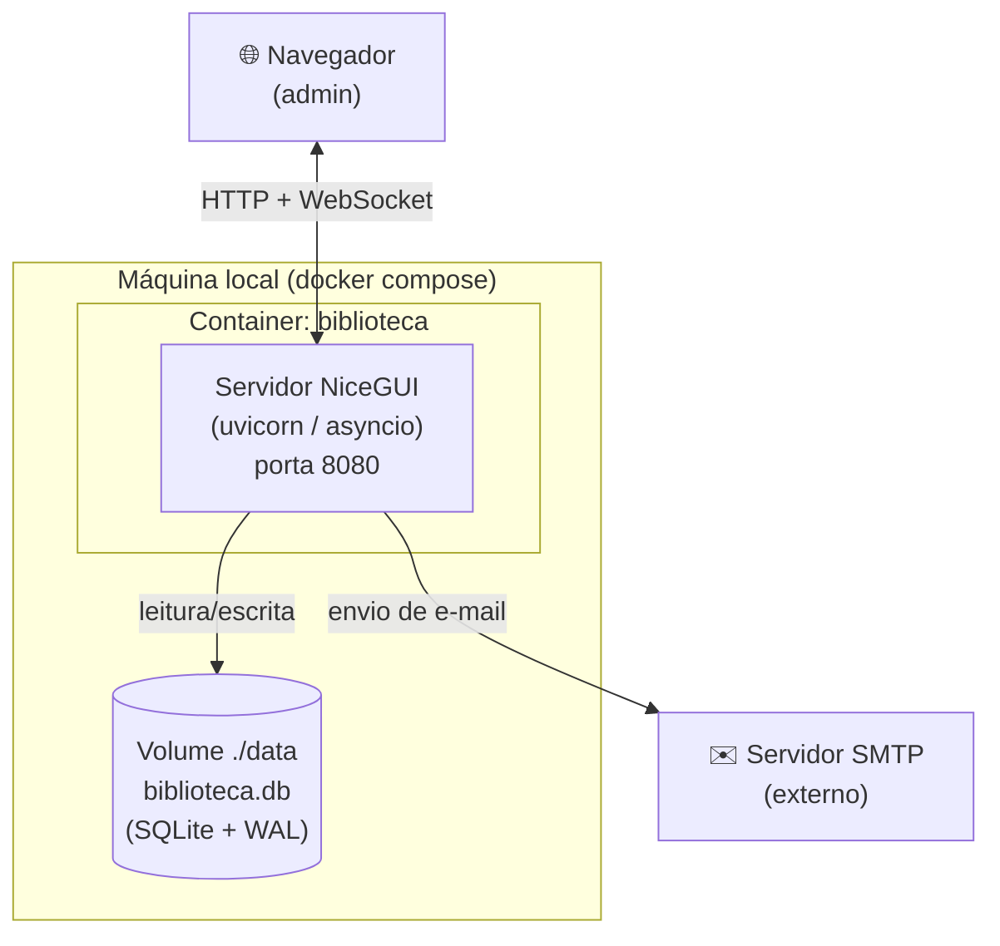
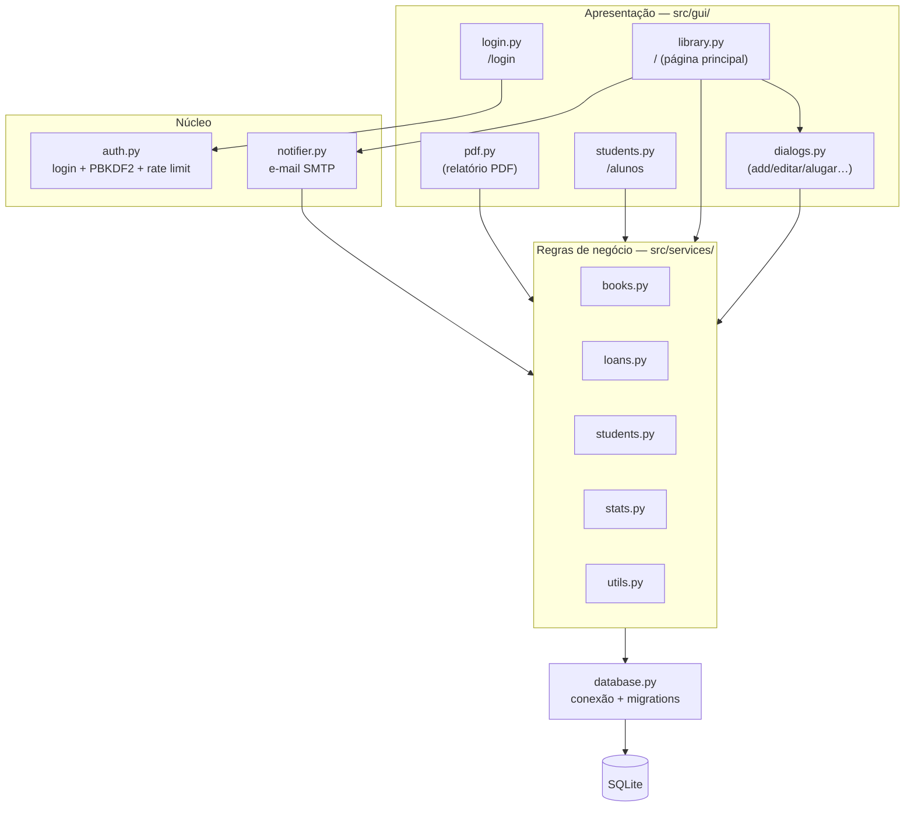
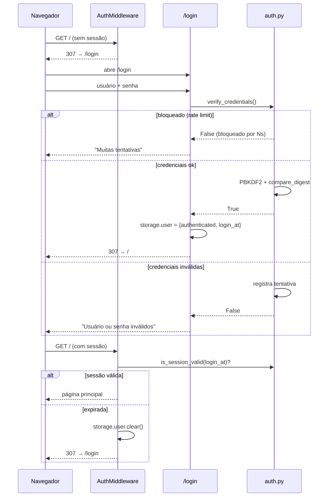
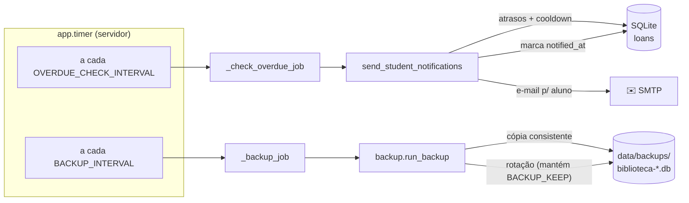

# Biblioteca SECRI

Sistema de gerenciamento de biblioteca com interface web moderna.

## Como rodar

```bash
docker compose up -d
```

Acesse: **http://localhost:8080**

O container reinicia automaticamente se a máquina reiniciar.

> Para acessar de **outro PC na mesma rede** (incluindo quando o servidor roda em
> **WSL2**), veja [docs/ACESSO-REDE.md](docs/ACESSO-REDE.md). `localhost` só
> funciona na própria máquina; de outro PC use o IP do servidor.

## Funcionalidades

- Login de administrador (app protegido por autenticação)
- Backup automático do banco com rotação
- Registro de auditoria das ações (quem fez o quê)
- Cadastro de livros (título, autor, categoria, ano, código)
- Empréstimo com prazo de devolução e e-mail do aluno
- Devolução com confirmação
- Renovação de empréstimo
- Detecção automática de atrasos
- Notificação por e-mail para alunos com atraso (job no servidor, roda mesmo sem ninguém com o app aberto; intervalo via `OVERDUE_CHECK_INTERVAL`)
- Notificação manual para o gestor (relatório consolidado)
- Cadastro de alunos (página /alunos) com autocomplete no empréstimo
- Busca por título, autor ou categoria
- Filtros por categoria e status
- Relatórios (top livros, top alunos)
- Exportação de relatório em PDF
- Dashboard com métricas (total, disponíveis, alugados, atrasados, devoluções/mês)

## Configuração

Copie `.env.example` para `.env` e preencha:

```bash
cp .env.example .env
```

## Autenticação

O app inteiro fica protegido por login (admin único). As credenciais vêm de
variáveis de ambiente:

| Variável | Padrão | Descrição |
|----------|--------|-----------|
| `ADMIN_USER` | `admin` | Usuário admin |
| `ADMIN_PASSWORD` | `admin123` | Senha (**troque antes de usar de verdade**) |
| `AUTH_SECRET` | derivado | Segredo para assinar os cookies de sessão |
| `LOGIN_MAX_ATTEMPTS` | `5` | Tentativas de login antes do bloqueio |
| `LOGIN_COOLDOWN_SECS` | `300` | Duração do bloqueio (segundos) |
| `SESSION_MAX_AGE_HOURS` | `8` | Validade da sessão antes de exigir novo login |

A senha é derivada com **PBKDF2-HMAC-SHA256** (KDF lento) e comparada de forma
time-safe, nunca em texto puro. Após várias tentativas erradas, o login é
bloqueado temporariamente (rate limiting). Sessões expiram após
`SESSION_MAX_AGE_HOURS`. Acesse `/login` para entrar; o botão de sair (ícone de
logout) fica no canto superior direito.

> ⚠️ `admin123` é uma senha fraca, só para testes locais. Defina
> `ADMIN_PASSWORD` e `AUTH_SECRET` por variável de ambiente em qualquer uso real.

## Performance e Confiabilidade

O envio de e-mail (SMTP) roda **fora do event loop** (`nicegui.run.io_bound`),
então a interface não congela — nem no timer horário de atrasos, nem ao clicar
em "Notificar Gestor". Isso elimina o **"Connection lost"** que ocorria quando o
SMTP bloqueava o servidor. O SMTP também tem timeout configurável
(`SMTP_TIMEOUT`, padrão 10s) para não travar em servidores lentos.

A listagem de livros usa uma única query (`books` + `LEFT JOIN` do empréstimo
ativo) em vez de várias queries por linha, e o banco tem índices em
`loans(book_id, return_date)` e `loans(return_date, deadline_date)`. O filtro
por categoria é aplicado no próprio SQL (não em Python), e o SQLite roda em modo
`WAL` com `synchronous=NORMAL` para reduzir o custo de I/O por operação.

O healthcheck do Docker bate em `/health` (resposta JSON leve), sem servir a
interface inteira a cada 30s.

### Benchmark

Para medir a performance das operações de dados com um volume realista:

```bash
docker run --rm -v $(pwd):/app -w /app python:3.11-slim sh -c \
  "PYTHONPATH=/app/src python tests/benchmark.py 5000"
```

## Popular com dados de teste

```bash
docker exec -e PYTHONPATH=/app/src 3d8731247171 python /app/seed.py
```

## Rodar testes

```bash
docker run --rm -v $(pwd):/app -w /app python:3.11-slim sh -c \
  "pip install -q pytest pytest-cov reportlab nicegui && PYTHONPATH=/app/src pytest tests/ -v --cov=src"
```

## Arquitetura

### Visão geral (deploy)

Um único container Docker roda o servidor NiceGUI. O estado persiste num
arquivo SQLite montado via volume; e-mails saem por SMTP externo.



### Camadas da aplicação

Separação clara entre apresentação (NiceGUI), regras de negócio (services,
testáveis sem UI) e persistência (SQLite).



### Fluxo de autenticação



### Jobs de servidor (timers)

Dois jobs periódicos rodam no servidor (não atrelados a cliente): notificação de
atrasos e backup do banco. Ambos executam o I/O bloqueante em thread
(`run.io_bound`) para não travar o event loop.


## Estrutura

```
├── src/
│   ├── main.py              # Servidor NiceGUI
│   ├── database.py          # Banco SQLite + migrations
│   ├── auth.py              # Autenticação do admin (hash + env)
│   ├── backup.py            # Backup do SQLite com rotação
│   ├── notifier.py          # Envio de e-mails
│   ├── services/
│   │   ├── books.py         # CRUD livros
│   │   ├── loans.py         # Empréstimos, devoluções, renovação
│   │   ├── students.py      # CRUD alunos
│   │   ├── stats.py         # Dashboard
│   │   ├── audit.py         # Registro de auditoria
│   │   └── utils.py         # Formatação, validação
│   └── gui/
│       ├── app.py           # Rotas
│       ├── login.py         # Página de login
│       ├── library.py       # Página principal
│       ├── dialogs.py       # Diálogos (adicionar, editar, alugar...)
│       ├── students.py      # Página de alunos
│       └── pdf.py           # Exportação PDF
├── tests/                   # 101 testes (pytest) + benchmark.py
├── data/                    # Banco SQLite (volume Docker, gitignored)
├── seed.py                  # Dados de teste
├── Dockerfile
├── docker-compose.yml
├── .env.example
└── README.md
```

## Stack

- Python 3.11
- NiceGUI (interface web)
- SQLite (banco de dados)
- ReportLab (PDF)
- Docker (deploy)
